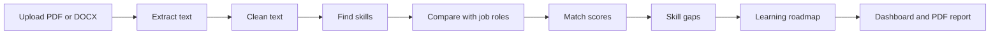

# ResumeLens: AI Resume Analyzer and Job Recommendation System

ResumeLens is a Streamlit app that helps students see how well their resume matches common technology roles. Upload a PDF or DOCX resume and get the skills it contains, a match score for each role, the top three recommended roles, a skill-gap analysis, a personalised learning roadmap and a downloadable PDF report.

> **For educational career guidance only.** ResumeLens is not a hiring or rejection tool. Its scores are estimates, not recruiter decisions.

## Screenshots

| Dashboard | Role recommendations |
|---|---|
|  |  |


## Features

- Upload a PDF or DOCX resume (up to 5 MB). Empty, corrupted, password-protected and scanned files get a clear message.
- Reads DOCX tables (including tables inside tables), text boxes, headers and footers.
- Cleans text without damaging technical terms such as C++, C#, .NET and Node.js.
- Finds skills from a 57-skill dictionary in 7 categories, including aliases and hyphenated spellings.
- Compares the resume with 8 job roles using TF-IDF and cosine similarity plus required and bonus skill coverage.
- Transparent match score from 0 to 100, with the formula explained in the app.
- Top three recommended roles with plain-language explanations.
- Skill-gap view for any target role.
- Rule-based learning roadmap with topics, practice projects and weekly milestones.
- Interactive Plotly charts and a responsive dashboard.
- Downloadable PDF report built in memory. It contains analysis results only, not the resume text.
- Automated tests, synthetic sample resumes and an evaluation sheet.

## How it works



| Step | File |
|---|---|
| Upload checks and text extraction | `resume_parser.py` |
| Text cleaning | `text_cleaner.py` |
| Skill detection | `skill_extractor.py` |
| Role matching, scoring and recommendations | `job_matcher.py` |
| Learning roadmap | `roadmap_generator.py` |
| PDF report | `report_generator.py` |
| Dashboard | `app.py`, `ui_styles.py`, `charts.py` |

## How the match score works

```
Match score = 60% x required-skill coverage
            + 15% x bonus-skill coverage
            + 25% x wording similarity
```

- **Required-skill coverage:** the share of a role's core skills found in the resume.
- **Bonus-skill coverage:** the share of the role's extra skills found.
- **Wording similarity:** TF-IDF cosine similarity between the resume and the role description, scaled so that 0.5 or more counts as full marks.

The weights and the 0.5 cap are design choices made for clarity. They are not learned from hiring data.

## Getting started

Requirements: Python 3.12 or 3.13 and Git.

**Windows (PowerShell)**

```powershell
git clone https://github.com/Manvi1034/resumelens.git
cd resumelens
py -m venv venv
.\venv\Scripts\Activate.ps1
python -m pip install -r requirements.txt
streamlit run app.py
```

If PowerShell blocks the activation script, run `Set-ExecutionPolicy -Scope CurrentUser -ExecutionPolicy RemoteSigned` once and try again.

**macOS or Linux**

```bash
git clone https://github.com/Manvi1034/resumelens.git
cd resumelens
python3 -m venv venv
source venv/bin/activate
python -m pip install -r requirements.txt
streamlit run app.py
```

The app opens at http://localhost:8501.

## Using the app

1. Upload a PDF or DOCX resume in the sidebar.
2. Review the skills found, your role matches and the charts.
3. Choose a target role in the sidebar to see its skill gap and learning roadmap, then download the PDF report.

## Testing

```powershell
python -m pip install -r requirements-dev.txt
python -m pytest
python make_sample_resumes.py
python evaluate.py
```

`make_sample_resumes.py` creates synthetic resumes (no real people) in `sample_resumes/`. The expected answers are in `tests/test_cases.csv`. `evaluate.py` runs every sample through the pipeline and writes `tests/evaluation_results.csv` with the top role, skill precision and skill recall for each resume.

## Extending the datasets

- **New skill:** add a row to `data/skill_dictionary.csv` (name, category and aliases separated by `|`).
- **New role:** add a row to `data/job_roles.csv` using skill names exactly as they appear in the dictionary, and add learning rows for any new skills in `data/learning_resources.csv`.
- Run `python -m pytest`. The tests catch typos, duplicates and unknown skills.

## Responsible AI and privacy

- Use it for guidance, not for hiring or rejection decisions.
- Only job-related skills and wording are scored. Age, gender, religion, nationality, marital status, disability and photographs are not used, and a test checks that adding them does not change any score.
- Emails, phone numbers and links are removed before analysis.
- Resumes are processed in memory and are not saved by this app. If you use a hosted copy, your file still passes through the host's servers, so use sample resumes for demos.
- A missing keyword does not mean a missing ability.

## Limitations

- Skills are found by keyword matching, so ordinary words can be mistaken for skills ("excel at" counts as Excel), negation is not understood ("not Java" still finds Java), and synonyms outside the dictionary are missed.
- A resume made only of repeated keywords can still earn a moderate score.
- All required skills count equally, so a role can look stronger than it is when its defining skill is missing.
- Scanned (image-only) PDFs are not supported because they need OCR.
- The role skill lists are a curated starting point, and real job postings vary.
- Roadmap durations are rough estimates for a beginner.

## Future work (not implemented)

- Semantic matching with Sentence Transformers.
- Resume section detection (education, projects, experience).
- Custom job description upload.
- Optional AI-written feedback, with a clear privacy notice.
- Per-skill weights so core skills count more.

## Project structure (main files)

```
resumelens/
├── app.py                   Streamlit dashboard (entry point)
├── resume_parser.py         PDF and DOCX validation and text extraction
├── text_cleaner.py          Text cleaning that protects C++, C#, .NET, Node.js
├── skill_extractor.py       Dictionary-based skill detection
├── job_matcher.py           TF-IDF, scoring and recommendations
├── roadmap_generator.py     Rule-based learning roadmap
├── report_generator.py      PDF report (ReportLab)
├── ui_styles.py             Theme and HTML helpers
├── charts.py                Plotly charts
├── make_sample_resumes.py   Creates synthetic sample resumes
├── evaluate.py              Writes the testing sheet
├── requirements.txt         Runtime dependencies
├── requirements-dev.txt     Adds pytest
├── data/                    Skills, roles and learning resources (CSV)
├── sample_resumes/          Synthetic resumes
├── tests/                   Tests, expected answers and evaluation results
└── docs/                    Screenshots and notes
```

## Tech stack

| Part | Tool |
|---|---|
| Interface | Streamlit |
| PDF and DOCX reading | pypdf, python-docx |
| Matching | scikit-learn (TF-IDF, cosine similarity) |
| Data | pandas, NumPy |
| Charts | Plotly |
| PDF report | ReportLab |
| Tests | pytest |

## Acknowledgements

Built as a college major project following the Unlox student project guidance for an AI Resume Analyzer and Job Recommendation System.

Built by Manvita Kalal.